  

  
  
  

## 👋 Hello, I'm Resika

I'm a vocational high school student in Software & Game Development, doing my PKL (internship) at Universitas Teknologi Digital Indonesia. I'm at the start of my developer journey, so I build to learn: every project here is a step up from the last one.

Right now I'm focused on **full-stack web development with TypeScript**, and I love designing dark-mode interfaces with a neon glow.

| | |
| :-- | :-- |
| 🎯 **Goal** | Become a Full-Stack Software Engineer |
| 🌱 **Learning** | TypeScript, React, and connecting front-end to back-end |
| 🤝 **Open to** | Internships, collaborations, and honest feedback |
| ⚡ **Fun fact** | I'm a sucker for Dark Mode and Cyberpunk UI |

## 🚀 Projects

> Click a project to expand it.

<b>🌾 Agri-Marketplace</b> &nbsp;·&nbsp; <code>TypeScript</code>

 

A digital marketplace for agricultural products from Pacitan.

🔗 [View repository](https://github.com/resika26/agri-marketplace)

<b>🏖️ WEB Jelajah Pacitan</b> &nbsp;·&nbsp; <code>HTML</code> <code>CSS</code>

 

An information portal for the beaches and caves of Pacitan.

🔗 [View repository](https://github.com/resika26/WEB-Jelajah-Pacitan)

<b>☕ Kopi Kenangan Senja</b> &nbsp;·&nbsp; <code>HTML</code> <code>CSS</code>

 

A modern landing page for a coffee shop with an aesthetic interface.

🔗 [View repository](https://github.com/resika26/kopi-kenangan-senja)

<b>🌤️ Cuaca App</b> &nbsp;·&nbsp; <code>JavaScript</code> <code>REST API</code>

 

A weather app that shows forecasts using data from a public REST API.

🔗 [View repository](https://github.com/resika26/cuaca-app)

## 🗺️ Learning Roadmap

- [x] Build responsive websites with HTML & CSS
- [x] Fetch and display data from a REST API
- [x] Build my first TypeScript project
- [ ] Build a back-end with Node.js and a database
- [ ] Add authentication (login & register)
- [ ] Deploy a full-stack app and share the live demo

## 🧰 Tech Stack

  

  

## 🐍 Contribution Snake

  

## 📬 Let's Connect

  
  

<i>Thanks for stopping by. Feedback is always welcome! ✨</i>

<!--
Catatan (hapus sebelum dipublikasikan):
1. Ganti GANTI_DENGAN_URL_LINKEDIN_ANDA dengan URL LinkedIn Anda, atau hapus tombolnya.
2. Folder assets/ (header.svg dan divider.svg) harus diunggah ke repo yang sama.
3. Baris PKL boleh dihapus jika tidak ingin ditampilkan.
4. Roadmap bisa diedit: ubah [ ] menjadi [x] saat target tercapai.
5. Bagian Contribution Snake butuh GitHub Action dan branch "output" (sudah Anda punya).
-->
